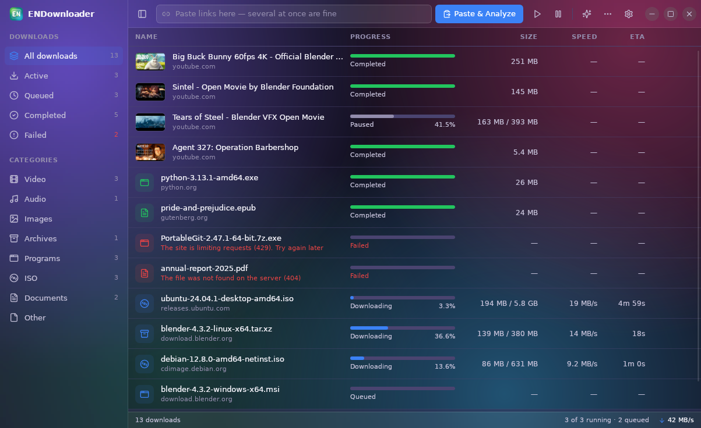

# ENDownloader

A fast download manager for **Ubuntu** and **Windows**: files of any type and media from
sites (YouTube, TikTok, Instagram… via yt-dlp), singly or in bulk, in parallel and in the
background, with resume after restarts and crashes. Built with Tauri 2, Rust and React.
Sister apps: **ENViewer** (images) and **ENPlayer** (video and music); same look and settings.

Status: **Phase 2** is done. The aria2 engine downloads files over several connections, with a
queue that runs several downloads at once, pause/resume, automatic retries, and resume after a
crash or restart. Phase 3 (in progress): media sites through yt-dlp + FFmpeg — links from
YouTube, TikTok, Instagram… open an analysis card (thumbnail, title, Video/Audio quality
table) and download the chosen format; playlists can be downloaded in bulk. How it works:
[docs/how-it-works.md](docs/how-it-works.md).

aria2: on Ubuntu the `.deb` depends on the `aria2` package; Windows bundles the official
`aria2c.exe` (fetched with a checksum check by `scripts/fetch-sidecars.sh`).



How to use it: [docs/USER_GUIDE.md](docs/USER_GUIDE.md).

## Install

Download from [Releases](https://github.com/mestiaque/endownloader/releases/latest):

| System | File | Notes |
|---|---|---|
| Ubuntu 22.04+ | `ENDownloader_<version>_amd64.deb` | `sudo apt install ./ENDownloader_*_amd64.deb` (pulls in `aria2` and `ffmpeg`) |
| Any Linux | `ENDownloader_<version>_amd64.AppImage` | `chmod +x` and run; install `aria2` and `ffmpeg` yourself |
| Windows 10/11 | `ENDownloader_<version>_x64-setup.exe` | Installer, no admin rights needed; aria2 included |
| Windows (no install) | `ENDownloader-portable-windows-x64.zip` | Unzip anywhere; settings stay in the `data` folder next to it |

Nothing else to install: yt-dlp (kept up to date), Deno and, on Windows, FFmpeg are downloaded
automatically when first needed, each checked against its published SHA-256.

**Updates.** ENDownloader asks GitHub for a newer release about once a day (Settings → General →
*Check for updates automatically*, or *Check now*). The `.deb`, AppImage and Windows installer
update themselves in place; the portable zip and development builds open the download page instead.

**Releasing.** Bump the version in `package.json`, `Cargo.toml` (workspace) and
`src-tauri/tauri.conf.json`, then push a tag `vX.Y.Z`. The `build` workflow tests, bundles both
platforms and publishes the release that installed copies pick up.

## Quick start (development)

```bash
npx pnpm@9.15.0 install
npx pnpm@9.15.0 tauri dev        # needs libwebkit2gtk-4.1-dev etc. on the host
```

Without the WebKit dev packages, build in Docker (uses `endl-build`, or ENViewer's `lumen-build`):

```bash
scripts/docker/run.sh "pnpm tauri build --debug --no-bundle"   # → target/debug/endownloader
scripts/docker/run.sh "dbus-run-session -- scripts/test/smoke-ui.sh"   # headless UI smoke test + screenshots in target/smoke
```

Command line: `endownloader "<url>" [more urls] [--folder X] [--quality 1080] [--minimized]`.
A second launch hands its links to the running window.

## Layout

```
crates/endl-core/   pure Rust, unit-tested: errors, task state machine, engine trait, SQLite store,
                    settings + categories, link extraction, file names, CLI parsing, secret masking
src-tauri/          Tauri shell: commands, queue events, tray, close-to-tray, autostart, logging
src/                React UI: engines/ (pure helpers + tests), store/ (zustand), components/
crates/endl-core/src/aria2.rs      aria2c process + JSON-RPC engine
crates/endl-core/src/scheduler.rs  queue runner: parallel slots, pause/resume, retries, conflicts, progress batching
scripts/            Docker build environment, sidecar fetch, headless tests, local Range test server
docs/               how downloading works (ranges, HLS/DASH, yt-dlp, FFmpeg, DRM)
```

## Tests

```bash
cargo test -p endl-core          # unit tests + scheduler (fake engine) + aria2 end-to-end (skipped without aria2c)
scripts/docker/run.sh "cargo test -p endl-core --test aria2_e2e -- --nocapture --test-threads=1"
scripts/docker/run.sh "dbus-run-session -- scripts/test/phase2-crash-resume.sh"   # real app: 5 parallel, kill -9, restart, all resume
npx pnpm@9.15.0 test             # task views, progress (never a fake %), ETA
```
