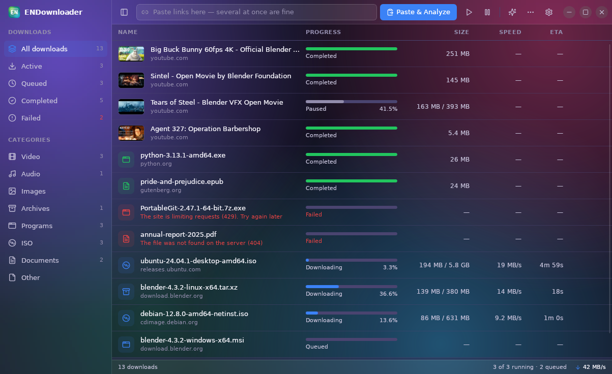
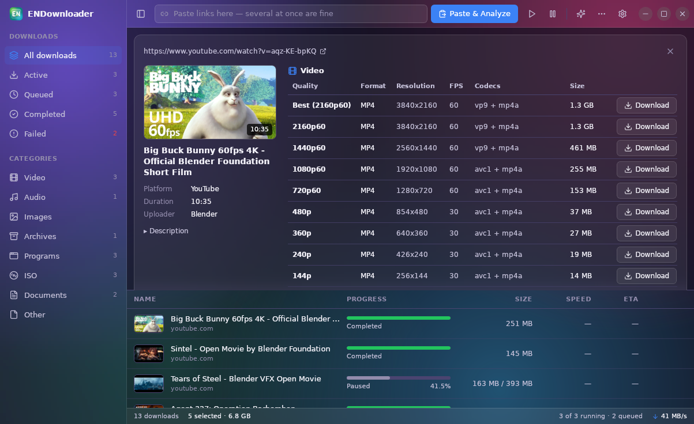
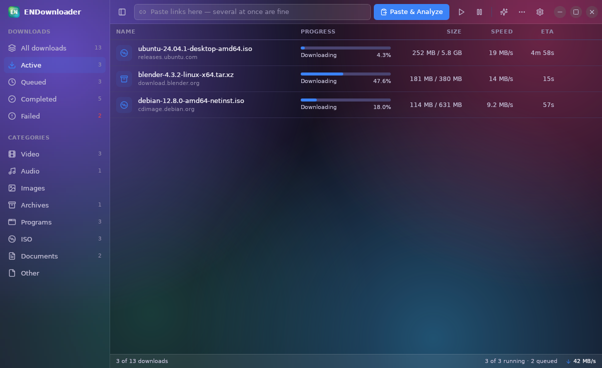
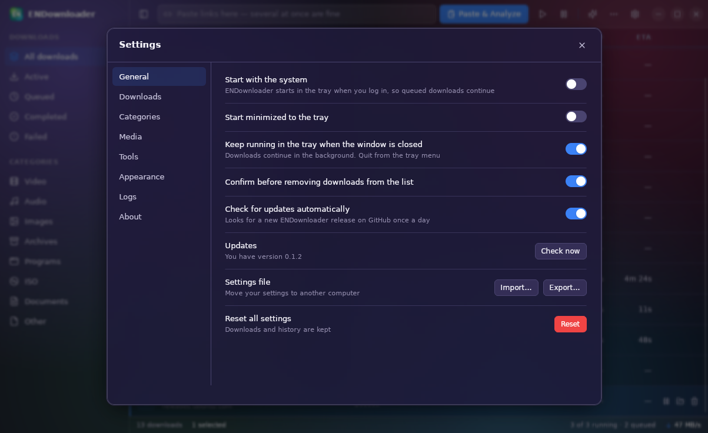
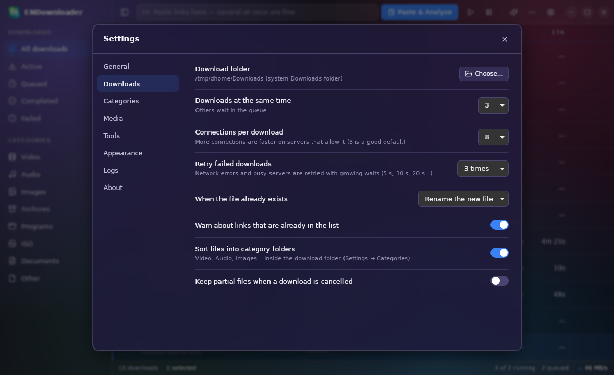
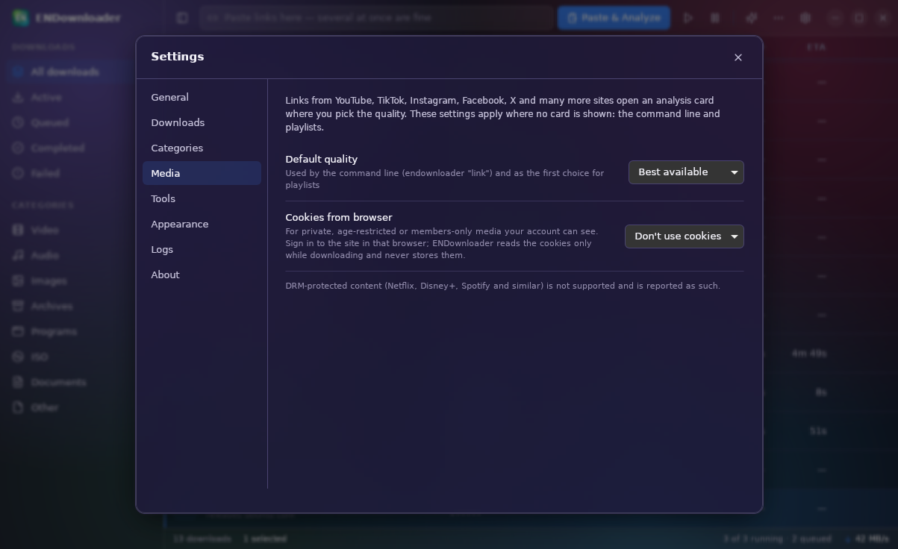
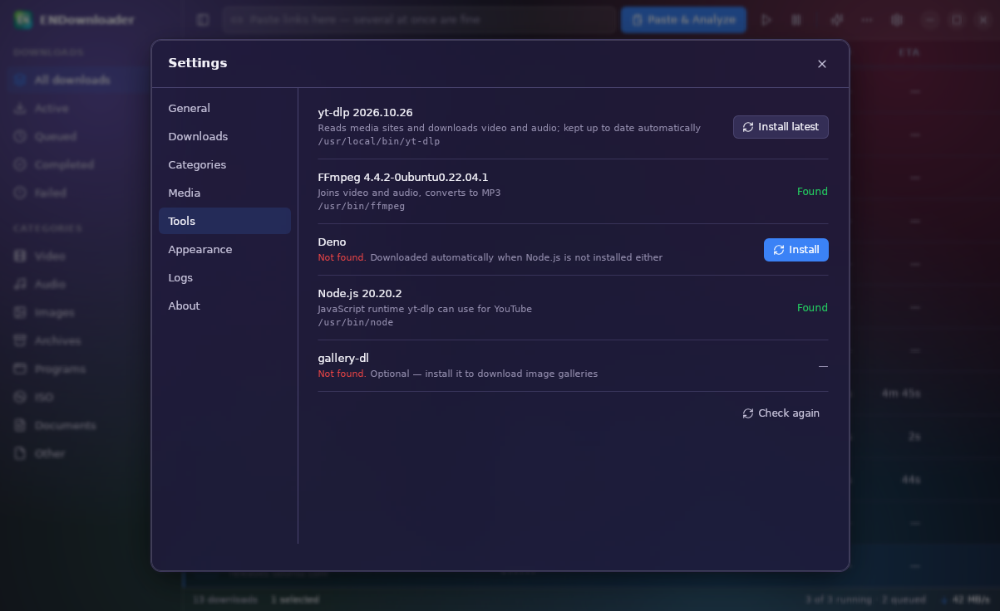

# ENSave user guide

ENSave downloads files and media from links. It can run several downloads at once,
keeps going in the background, and resumes after a restart or crash.

## Installing

Get the latest version from the
[Releases page](https://github.com/mestiaque/ensave/releases/latest).

| System | File | How |
|---|---|---|
| Ubuntu 22.04 or newer | `ENSave_<version>_amd64.deb` | `sudo apt install ./ENSave_*_amd64.deb` |
| Any Linux | `ENSave_<version>_amd64.AppImage` | Make it executable (`chmod +x`), then run it |
| Windows 10/11 | `ENSave_<version>_x64-setup.exe` | Run the installer (no administrator rights needed) |
| Windows, no install | `ENSave-portable-windows-x64.zip` | Unzip anywhere and run `ENSave.exe` |

You don't need to install anything else. The tools ENSave uses are set up for you:

* On Ubuntu, the `.deb` installs `aria2` and `ffmpeg`.
* On Windows, aria2 is included.
* yt-dlp, Deno and (on Windows) FFmpeg are downloaded the first time they are needed.

## Adding downloads

You can add downloads in any of these ways:

* **Paste links** into the box at the top and press **Paste & Analyze**. You can paste
  several links at once, one per line or mixed into other text.
* **Drag and drop** links from a browser, or a `.txt` file of links, onto the window.
* **Import a link list**: ••• → *Import links from file…*.
* **Command line**: `ensave "<link>" [more links] [--folder X] [--quality 1080]`.
  If ENSave is already open, the links go to that window.

ENSave sorts each file into a category by its type (Video, Audio, Programs, ISO…).
If *Sort files into category folders* is on, each category also gets its own folder.

## Videos and music from websites

When you add a link from YouTube, TikTok, Instagram, Facebook, X or another media site,
ENSave opens a card for it. The card shows:

* the thumbnail, title, length and uploader;
* the **Video** qualities (resolution, frame rate, codecs and size);
* the **Audio** choices: the best original audio (M4A) or **MP3**.

Click **Download** next to the quality you want. ENSave downloads the video and audio
and joins them into one MP4 file.

* **Playlists**: if the link is part of a playlist, click **Show the whole playlist**.
  Then tick the videos you want and choose one quality for all of them.
* **Private or members-only videos**: in Settings → Media, choose your browser under
  *Cookies from browser*. ENSave then uses your sign-in from that browser. It reads the
  cookies only while downloading and never stores them.
* **DRM**: protected content (Netflix, Disney+, Spotify and similar) cannot be downloaded.
  ENSave tells you when a link is protected.

## Watching your downloads

The sidebar filters the list:

* **Downloads**: *Active*, *Queued*, *Completed* and *Failed*.
* **Categories**: Video, Audio, Programs and so on.

Each row shows the progress, size, speed and time left. The status bar at the bottom shows
how many downloads are running and the total speed.

* **Several at once**: by default 3 downloads run together and the rest wait in the queue.
  A file can also download over several connections, which is often faster.
* **Pause and resume**: right-click a download, or press `Space`. A paused download keeps
  what it already has.
* **Problems**: network errors and busy servers are retried automatically. If a download
  still fails, the row says why (for example *The site is limiting requests (429)*), and
  **Download again** tries once more.
* **After a crash or restart**, unfinished downloads continue from where they stopped.

Right-click a download (or several) to open its menu: **Resume**, **Pause**,
**Download again**, **Cancel**, **Open file**, **Show in folder**, **Copy link**,
**Remove from list**, **Delete with files…**.

## Keyboard shortcuts

| Key | Action |
|---|---|
| `Ctrl+,` | Settings |
| `?` | All keyboard shortcuts |
| `↑` / `↓`, `Home` / `End`, `PgUp` / `PgDn` | Move through the list (`Shift` extends the selection) |
| `Ctrl+A` / `Esc` | Select all / clear the selection |
| `Space` | Pause or resume the selected downloads |
| `Enter` | Open the finished file |
| `Delete` / `Shift+Delete` | Remove from the list / delete with files |
| `Ctrl+B` | Show or hide the sidebar |

## Running in the background

When you close the window, ENSave keeps running in the system tray and your
downloads continue. Use the tray icon to show the window, pause or resume everything, or
quit. To quit from the window, use ••• → *Quit ENSave*.

*Start with the system* (Settings → General) starts ENSave in the tray when you log
in, so queued downloads continue.

## Settings

Open Settings with `Ctrl+,` or the gear button.

* **General**: starting with the system, the tray, update checks, and moving your
  settings to another computer.
* **Downloads**: the download folder, how many downloads run at once, connections per
  download, retries, and what happens when a file already exists.
* **Categories**: which file types go into each category and folder.
* **Media**: the default quality (for the command line and playlists) and cookies from
  your browser.
* **Tools**: the helper programs ENSave uses. You normally don't need to change
  anything here.
* **Appearance**: the theme (Dark, Light, Glass, System) and the accent colour. The
  theme button in the toolbar switches it quickly.
* **Logs**: what ENSave has been doing, useful when you report a problem.

### Helper tools

| Tool | What it does | How you get it |
|---|---|---|
| aria2 | Downloads files over several connections | `.deb` dependency (Ubuntu), included (Windows) |
| yt-dlp | Reads media sites | Downloaded automatically; updated when a new version comes out |
| FFmpeg | Joins video and audio, makes MP3s | `.deb` dependency (Ubuntu), downloaded automatically (Windows) |
| Deno or Node.js | Lets yt-dlp read YouTube | Deno is downloaded automatically if neither is installed |

Every tool ENSave downloads comes from its official release and is checked against
its published SHA-256 checksum before it is used.

## Updates

ENSave checks GitHub for a new version about once a day. When one is available, it
shows a message with an **Update** button. The update downloads, is checksum-verified and
installs in place:

* `.deb`: Ubuntu asks for your password.
* AppImage: the file is replaced.
* Windows installer: the update installs silently and ENSave restarts.

Your downloads, queue and settings are kept. To check now, use Settings → General →
**Check now**. You can turn the automatic check off there too.

The portable Windows zip updates itself too: the new version is unpacked and copied over the folder when ENSave restarts (your `data` folder is kept).

## Privacy

ENSave only connects to:

* the links you add;
* GitHub, to check for its own updates and to download yt-dlp, Deno and FFmpeg.

Nothing about your downloads is sent anywhere.

---

*The media examples in the screenshots are Blender Foundation open movies (Big Buck Bunny,
Sintel, Tears of Steel, Agent 327), © Blender Foundation, licensed under Creative Commons
Attribution. The file downloads in the screenshots come from a local test server.*
